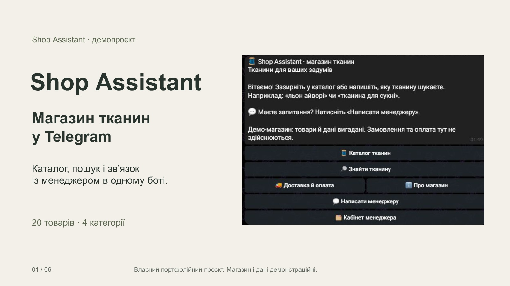

# Shop Assistant Bot

[](https://github.com/OlehHavrilko/shop-assistant-bot/actions/workflows/tests.yml)


**Telegram-бот для магазину: каталог із фото, пошук товару за словами й передача діалогу менеджеру.** Працює без платного AI, на одному VPS, з даними з Excel/CSV.

[▶ Відкрити демо в Telegram](https://t.me/shopasisstanthvrlko_bot) · [Робота на Freelancehunt](https://freelancehunt.com/showcase/work/shop-assistant-telegram-bot-dlya-magazinu/2091547.html) · [English](README.en.md)



## Яку задачу вирішує

Клієнти магазину в Telegram ставлять ті самі запитання: «чи є льон айворі?», «скільки коштує?», «як доставляєте?». Бот відповідає на них сам, із точними цінами й залишками з каталогу, а складні розмови передає менеджеру з контекстом товару.

| Для клієнта | Для менеджера | Для власника |
| --- | --- | --- |
| Каталог за категоріями з фото й характеристиками | Кабінет звернень з іменем і @username клієнта, історією й архівом | Оновлення каталогу: надіслати боту Excel/CSV, переглянути зміни, підтвердити |
| Пошук українською, російською й англійською, з виправленням описок | Відповідь текстом, фото, файлом або Telegram Reply | Статистика: звернення, швидкість відповіді, оцінки, заявки |
| Заявка на покупку з картки: метри, телефон, доставка | Шаблони відповідей і картка товару клієнту одним натиском | Що шукали й не знайшли — попит, якого немає в асортименті |
| Фото, голосові й файли менеджеру в зверненні | Нагадування про звернення без відповіді | Робочі години: автовідповідь клієнту поза ними |
| Оцінка роботи менеджера після завершення | Окрема тема Telegram на кожне звернення | Ціни й залишки тільки з БД; закупівельні ціни клієнту не видно |

Демо показує вигаданий магазин тканин: 20 товарів, чотири категорії, ліцензовані ілюстративні фото. Ціни й залишки демонстраційні; бот збирає заявки для менеджера, але не приймає оплату й не резервує тканину.

## Як це зроблено

- **Надійність:** дедуплікація `update_id`, черга відправлення (outbox) з повторами, коректна зупинка за SIGTERM. Режим діалогу й звернення переживають перезапуск.
- **Дані:** SQLite, ціни в `Decimal`, атомарний імпорт CSV/XLSX із валідацією та номерами рядків; помилковий файл не псує поточний каталог.
- **Пошук:** детермінований, без моделі: точний SKU, нормалізація, словник синонімів UK/RU/EN і виправлення описок (`льон айвори`, `мусслин`). Незнайомі слова не підставляють випадковий товар.
- **AI як опція:** розширення на Anthropic із жорстким денним бюджетом, який резервується в SQLite **до** виклику. Без ключа бот працює повністю.
- **DevOps:** Docker без root і без відкритих портів, named volume, CI з `ruff` і `pytest` на Python 3.11/3.12, окремий прогін без AI SDK.
- **Тести:** 205 автотестів і 40 перевірочних запитів до пошуку. [Як перевірено](docs/VERIFICATION.md).

## Що можна адаптувати під ваш магазин

- Свій каталог і фото з Excel/CSV, будь-яка тематика товарів.
- Кошик, замовлення й оплата (LiqPay, Monobank, WayForPay).
- Синхронізація з 1С, CRM або Google Sheets за розкладом.
- Робота в групах, кілька менеджерів із розподілом звернень.
- Вебадмінка для товарів, заявок і статистики; вивантаження заявок у CRM.
- AI-консультант на базі каталогу, з контролем витрат.

## Локальний запуск

PowerShell із кореня проєкту:

```powershell
python -m venv .venv
.\.venv\Scripts\python.exe -m pip install -e ".[dev]"
.\.venv\Scripts\python.exe -m shop_assistant import examples/store_catalog.csv
.\.venv\Scripts\python.exe -m shop_assistant search --sku 00123
.\.venv\Scripts\python.exe -m shop_assistant search --name "Льон Siena" --shade ivory
.\.venv\Scripts\python.exe -m pip check
.\.venv\Scripts\python.exe -m ruff check src tests evals
.\.venv\Scripts\python.exe -m pytest -q
```

Імпорт і пошук не потребують токенів чи мережі. Типова БД CLI — `data/catalog.sqlite3`; інший шлях задається **перед** командою:

```powershell
.\.venv\Scripts\python.exe -m shop_assistant --db data/demo.sqlite3 import examples/store_catalog.csv
.\.venv\Scripts\python.exe -m shop_assistant --db data/demo.sqlite3 search --sku 00123
```

`00123` — «Льон Siena», ivory, 345.50 грн/м, 12.75 м, дані від `2026-10-15T09:00:00+00:00`. Артикул `123` — окремий білий Siena із нульовим залишком. Для `COT-010` залишок невідомий. Дані довідкові, а не отримані наживо з облікової системи.

Для Telegram задайте **оточення процесу**. Нижче заглушки: підставте токен тестового бота й числовий ID менеджера локально. Менеджер повинен відкрити чат із ботом і натиснути Start.

```powershell
$env:TELEGRAM_BOT_TOKEN = "replace_with_test_bot_token"
$env:MANAGER_TELEGRAM_ID = "123456789"
$env:DATABASE_PATH = "data/catalog.sqlite3"
$env:LLM_ENABLED = "false"
$env:STORE_DATA_PATH = "examples/store.json"
.\.venv\Scripts\python.exe -m shop_assistant run
```

`run` читає шлях із `DATABASE_PATH`, а не CLI `--db`. Програма **не завантажує `.env` автоматично**. [.env.example](.env.example) описує всі налаштування; для локального Python передайте їх через оточення. Для початкового імпорту під час запуску явно задайте `DEMO_CATALOG_PATH=examples/store_catalog.csv`: імпорт застосовується лише до порожнього каталогу, наявні товари не замінюються. `examples/catalog.csv` — старий маленький каталог для регресійних тестів та окремого набору оцінки LLM.

## Клієнт і менеджер

Інтерфейс український, підтримуються лише особисті чати.

| Хто | Команда або дія | Результат |
| --- | --- | --- |
| Обидві ролі | `/start`, `/help` | Вітання Shop Assistant, меню каталогу, пошуку та інформації про магазин. |
| Обидві ролі | «Каталог тканин» | Чотири категорії, до чотирьох фотокарток на сторінці й кнопка «Ще тканини». |
| Клієнт | Точний SKU, наприклад `00123` | Картка з каталогу без LLM. |
| Обидві ролі | `льон айворі`, `хлопок синий`, `тканина для сукні` | Безкоштовний пошук; за кількох збігів — вибір товару кнопками. |
| Обидві ролі | «Про магазин», «Доставка й оплата» | Довідка вигаданого магазину без AI-викликів. |
| Клієнт | «Запитати менеджера» в картці | Звернення з обраним артикулом у контексті. |
| Клієнт | «Оформити заявку» в картці | Метри, телефон, спосіб доставки й коментар; заявка з орієнтовною сумою йде менеджеру. |
| Клієнт | `/manager` | Режим HUMAN, номер звернення й повідомлення менеджеру. |
| Клієнт | Фото, файл чи голосове у зверненні | Копія менеджеру з підписом «Клієнт надіслав». |
| Клієнт | Зірки після завершення | Оцінка 1–5 зберігається один раз і видна менеджеру. |
| Менеджер | `/tickets` або «Кабінет менеджера» | Активні звернення, контекст, історія, архів і відкриття діалогу. |
| Менеджер | Повідомлення у відкритому зверненні або Telegram Reply | Відповідь адресату цього звернення. |
| Менеджер | `/reply 12 текст відповіді` | Відповідь клієнту саме звернення №12. |
| Менеджер | `/bot 12` | Закриття звернення №12 та повернення цього діалогу боту. |
| Менеджер | «Шаблони відповідей» у зверненні | Готова відповідь клієнту одним натиском; тексти в `store.json`. |
| Менеджер | «Надіслати товар» або `/card АРТИКУЛ` | Картка з фото й кнопкою заявки у відкрите звернення. |
| Менеджер | `/stats` або «Статистика» | Звернення за добу й тиждень, перша відповідь, оцінки, заявки, ненайдені запити. |
| Менеджер | `/import` або «Оновити каталог» | Файл .xlsx/.csv до 5 МБ → перелік змін → «Застосувати» з резервною копією бази. |

Звернення без відповіді нагадує про себе менеджеру через `SUPPORT_REMINDER_MINUTES` (типово 15 хв, `0` вимикає) лише в робочі години. Робочі години й часовий пояс задає `working_hours` у `store.json`; поза ними клієнт один раз отримує автовідповідь із графіком.

Право менеджера визначає лише `MANAGER_TELEGRAM_ID`. У HUMAN повідомлення клієнта йдуть менеджеру, LLM не викликається; режим і прив'язка звернення переживають перезапуск. Звернення можна завершити кнопкою з підтвердженням; менеджер також може використати `/bot`. Історія й архів зберігаються.

Менеджер теж може відкрити `/start`, переглядати фото й шукати тканини зі свого акаунта. `/help` повертає ту саму вітрину; додаткова кнопка «Кабінет менеджера» відкриває робоче меню. За ввімкненого Threaded Mode кожне звернення має окрему тему у клієнта й менеджера; довільні теми користувача залишаються доступними для каталогу. [Маршрутизація та обмеження](docs/SUPPORT.md). Звернення до самого себе не створюється; наскрізний тест відповіді менеджера потребує іншого Telegram-користувача.

Пошук надає пріоритет точному SKU, нормалізує регістр і пунктуацію, враховує назву, відтінок, категорію, призначення й теги; повертає до 10 варіантів. Якщо точних збігів немає, слово з 4+ літер з опискою замінюється на близьке слово каталогу з тією самою першою літерою («вовна» не стає «бавовною»). Невідомі слова не відкидаються: збігу може не бути. Розуміння будь-якої фрази й рекомендацій за фотографією немає. Ціну, залишок, одиниці й дату формує сервер із SQLite. Вигадані або видалені SKU не стають картками.

`examples/store.json` містить опис магазину й публічні характеристики товарів за SKU; у `examples/media/` лежать локальні фото. Ціни, залишки та час актуальності з JSON не читаються. Фото ліцензовані та ілюстративні: вони не підтверджують точний колір або склад вигаданого товару. Джерела й ліцензія наведені в каталозі медіа.

## Формат каталогу

CSV: UTF-8, дозволено BOM, роздільник — кома. XLSX: перша вкладка, перший рядок — заголовки; SKU й дату зберігайте як текст. Формули заборонені, порядок колонок довільний. Обов'язкові заголовки:

```csv
sku,name,shade,price_uah_per_m,stock_m,updated_at
00123,Льон Siena,ivory,345.50,12.75,2026-10-15T12:00:00+03:00
```

| Поле | Правило |
| --- | --- |
| `sku`, `name`, `shade` | Непорожній текст до 200 символів; SKU залишається рядком, Excel-число відхиляється. |
| `price_uah_per_m` | Невід'ємне число: до 12 цифр перед крапкою й до 2 після. |
| `stock_m` | Такий самий формат; порожньо — немає даних, `0` — немає в наявності. |
| `updated_at` | ISO 8601 з `T` і часовим поясом; зберігається UTC. |
| `purchase_price_uah_per_m` | Необов'язкова закрита закупівельна ціна; формат як для ціни. |
| `supplier` | Необов'язковий закритий текст до 200 символів. |

Зайві чи повторні заголовки, повтор SKU, від'ємні числа, зайва точність, помилкова дата й порожній каталог відхиляються. Помилки містять номери рядків. Імпорт повністю замінює каталог однією транзакцією після валідації всього файлу; помилковий файл зберігає попередні дані. Вхідний файл не змінюється.

## LLM, ліміти та дані

Без ключа й при `LLM_ENABLED=false` працюють фотокаталог, текстовий пошук, довідка та менеджер. Базове встановлення `pip install -e .` і Docker-образ не містять Anthropic SDK. Для окремого локального експерименту встановіть `pip install -e ".[llm]"`; у власному Docker-образі також потрібна ця додаткова залежність. Платний режим не є умовою готовності демо. Для ввімкнення потрібні `LLM_ENABLED=true`, `ANTHROPIC_API_KEY`, `ANTHROPIC_MODEL`, додатний `LLM_DAILY_BUDGET_USD` і всі чотири актуальні USD-тарифи обраної моделі: `LLM_INPUT_USD_PER_MILLION`, `LLM_OUTPUT_USD_PER_MILLION`, `LLM_CACHE_WRITE_USD_PER_MILLION`, `LLM_CACHE_READ_USD_PER_MILLION`. Відсутні тарифи блокують платний запуск. Платну перевірку виконують лише після дозволу на витрати.

Типові межі: 2000 символів повідомлення, 20 запитів клієнта за 60 секунд, 3000 символів контексту менеджера, 16000 вхідних і 400 вихідних токенів, до 2 викликів моделі на повідомлення, тайм-аут виклику 15 секунд. Налаштування — в `.env.example`.

Верхня оцінка вартості резервується атомарно в SQLite **до** виклику. Враховуються паралельні резерви; поріг — 85% денного бюджету, доба за UTC. Відомий usage звіряє суму з фактичними токенами, тайм-аут із невідомим результатом залишає резерв. Перезапуск не обнуляє лічильник. При вичерпанні ліміту залишаються локальний пошук, каталог і передача менеджеру. SDK не повторює платні запити автоматично.

Закупівельна ціна й постачальник вилучені з публічної моделі **до** передачі результатів LLM. Модель не отримує Telegram ID, профіль клієнта, SQL чи доступ до файлів. У безкоштовному режимі запити не надсилаються AI-провайдеру. Лише після явного ввімкнення розширення текст запиту може обробляти зовнішній Anthropic; використовуйте вигадані повідомлення без особистих даних. Звичайні логи не містять повних клієнтських текстів; обмежений контекст звернень і черга зберігаються в SQLite. Там само зберігаються ім'я й @username клієнтів, телефони із заявок і нормалізовані ненайдені запити (до 80 символів). Фото й файли не копіюються на сервер: Telegram пересилає їх через `copyMessage`. БД, `backups/` і копії потребують доступу лише оператора.

## Docker і відновлення

Потрібні Docker та Compose. Образ перевірено на ARM64; базовий Python-образ також підтримує AMD64. Створіть власний `.env` за `.env.example`, заповніть необхідні значення. Для контейнера початковий каталог — `DEMO_CATALOG_PATH=/app/examples/store_catalog.csv`, опис вітрини — `STORE_DATA_PATH=/app/examples/store.json`. Відносні `examples/...` теж працюють у робочій папці контейнера. Значення `.env` підставляє **Compose**, а не Python:

```powershell
docker compose --env-file .env up -d --build
docker compose logs --tail 50 bot
docker compose restart bot
```

Контейнер працює без root, секрети не копіюються в образ, портів назовні немає: Telegram використовує long polling. Один бот — один процес і один polling-екземпляр; не масштабуйте сервіс кількома репліками. БД `/data/catalog.sqlite3` зберігається в named volume `catalog_data`. Фіксоване ім'я Compose-проєкту `shop-assistant-bot` зберігає прив'язку до volume між каталогами релізів; не перевизначайте його через `-p`. `docker compose down` зберігає volume; `down -v` видаляє каталог, звернення й бюджет.

Перевірка всередині вже налаштованого Compose:

```powershell
docker compose run --rm --no-deps bot python -m shop_assistant --db /data/catalog.sqlite3 search --sku 00123
docker compose run --rm --no-deps bot python evals/run.py
```

Тести запускаються з вихідного проєкту: runtime-образ не містить `tests` і README. Імпорт нового файлу — повна заміна каталогу; перед ним зробіть копію. [Розгортання й резервне копіювання](docs/DEPLOYMENT.md) описують роботу на Linux/VPS.

Вхідні `update_id` дедуплікуються, режим діалогу й outbox зберігаються транзакційно. Невдалі відправлення повторюються після паузи й перезапуску. Доставка — at-least-once: якщо Telegram прийняв повідомлення, але відповідь загубилася, повтор може створити дубль. Немає гарантії exactly-once або доставки заблокованому боту. При SIGINT/SIGTERM нові updates не приймаються, активна робота має до 80 секунд для завершення; Compose дає 90 секунд. Невідправлене залишається для наступного запуску.

## Перевірки й межі випуску

CI запускає `ruff`, встановлення, `pip check` і `pytest` на Python 3.11/3.12 — з Anthropic SDK і без нього, без секретів та мережевих API. Безкоштовна перевірка вітрини виконує 40 запитів і перевіряє факти, фото та підписи всіх 20 карток:

```powershell
.\.venv\Scripts\python.exe evals/free_run.py
```

Це перевірка справжнього локального пошуку, без моделі й мережевих викликів. Окремий старий набір `evals/run.py` збережено для необов'язкового LLM-розширення: його офлайн-валідація не вимірює якість моделі. [Оцінка LLM](evals/README.md) описує цей додатковий сценарій. [Сценарій демо](docs/DEMO.md) містить ручний Telegram-тест і необов’язковий сценарій відео 60–90 секунд. Підсумок перевірок — у [VERIFICATION.md](docs/VERIFICATION.md); журнал розробки — у [docs/dev](docs/dev/).

У демо немає оплати, кошика, резервування, розпізнавання фото, підбору аналогів, CRM/1С, вебадмінки й груп — це окремі доробки під конкретний магазин (див. «Що можна адаптувати»). Платний прогін LLM до приймання безкоштовної вітрини не входить. Код — [MIT](LICENSE); фотографії використовуються за ліцензією Pexels, [автори й джерела](docs/MEDIA_SOURCES.md).
